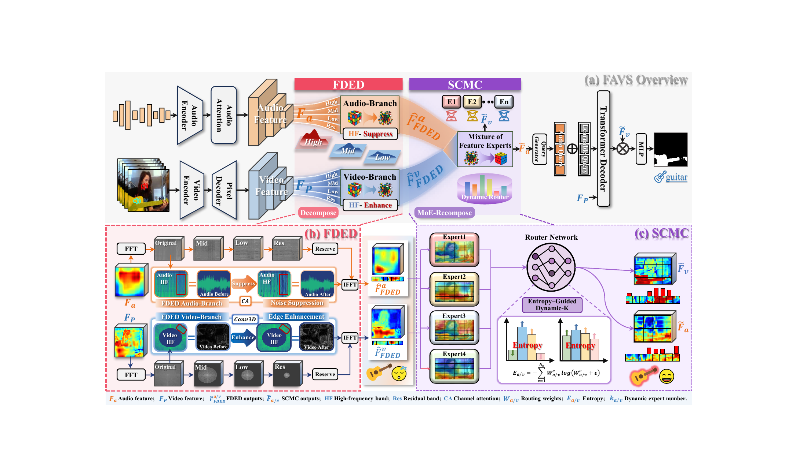

# FAVS

### Frequency-Domain Decomposition and Recomposition for Robust Audio-Visual Segmentation

**Kai Peng · Yunzhe Shen · Miao Zhang · Jia Wang · Leiye Liu · Wei Ji · Jingjing Li · Yongri Piao · Huchuan Lu**

## Overview

FAVS studies audio-visual segmentation through frequency-domain decomposition and recomposition. The paper introduces the Frequency-Domain Enhanced Decomposer (FDED) and Synergistic Cross-Modal Consistency (SCMC) modules to account for the different roles of audio and visual frequency components.

*Architecture overview from the manuscript.*

## Code release

The code is being organized for release. This repository currently contains only the project overview and architecture figure. Implementation code, training and inference scripts, and model weights are not included.
